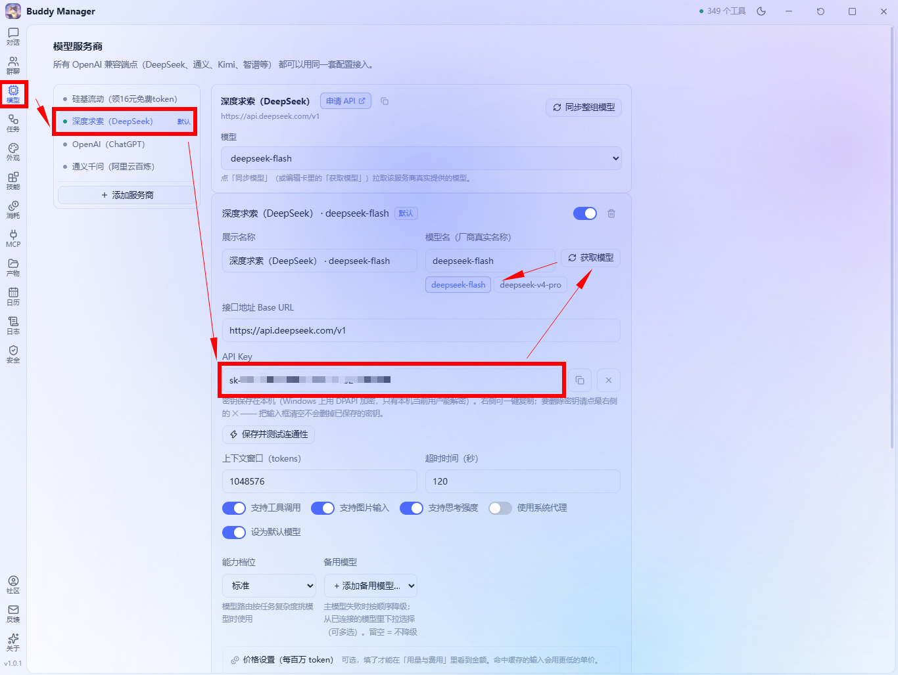
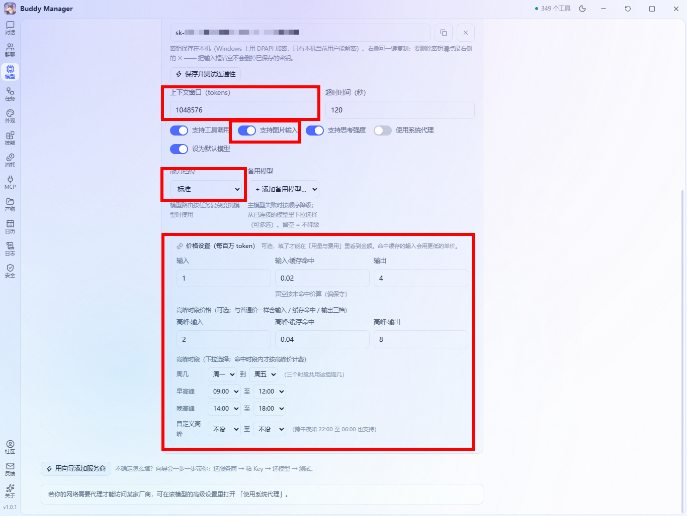

[English](./soulmate_agent.md) | [简体中文](./soulmate_agent.zh-CN.md) · [← Back](../README.md)

# Integrate with Soulmate Agent

Soulmate Agent is a local-first AI desktop agent for Windows and macOS, built with a Python core and an Electron shell. Conversations, memory, and API keys stay on the user's own machine, and the app does not lock you to a single model provider.

#### 1. Install Soulmate Agent

Download the Windows installer from [Releases](https://github.com/weixin97676414/soulmate-agent/releases/latest):

```
Soulmate-Agent-Setup-1.0.1.exe
```

macOS is supported by the project; follow the build steps in the [repository README](https://github.com/weixin97676414/soulmate-agent) (Python 3.13+ for the core, Node.js 20+ for the desktop shell).

#### 2. Configure DeepSeek

1. Open **模型** (Models) from the left icon rail.
2. Select **深度求索（DeepSeek）**. It ships as one of the preset providers.
3. Set **接口地址 Base URL** to `https://api.deepseek.com/v1`.
4. Create an API key at [platform.deepseek.com/api_keys](https://platform.deepseek.com/api_keys) and paste it into **API Key**. The key is encrypted with the OS keychain (Windows DPAPI) and is never stored in plaintext.
5. Choose the model name:
   - `deepseek-flash` — DeepSeek-V4.1-Flash; supports tool calls and vision
   - `deepseek-v4-pro` — DeepSeek-V4-Pro; supports tool calls, vision is not supported
6. Set **上下文窗口 (Context window)** to `1048576`.
7. Keep **支持工具调用 (Tool calls)** enabled. Enable **支持图片输入 (Image input)** only for `deepseek-flash`.
8. Enable **支持思考强度 (Thinking effort)**, then pick a **能力档位 (Capability tier)**. The three tiers map to DeepSeek's reasoning effort as follows:

| Capability tier | `reasoning_effort` |
| --- | --- |
| 便宜快速 (Fast & cheap) | `low` |
| 标准 (Standard) | `high` |
| 最强 (Maximum) | `max` |

9. Click **保存并测试连通性 (Save and test connection)**. The app sends a real request and reports the latency.





#### 3. Get started

Start a chat and give it a tool-using task, for example: "read this page and put the prices into a table". Tool cards show each call's status and duration, and every desktop action asks for confirmation before it runs.

#### Notes

- DeepSeek V4 supports 1M tokens of context (1,048,576) and up to 384K output tokens.
- Thinking mode is enabled by default. `reasoning_effort` accepts `low`, `high`, and `max`.
- `deepseek-flash` is the current model name for Flash. The legacy alias `deepseek-v4-flash` is still accepted by the API but the underlying model has been retired and is served by DeepSeek-V4.1-Flash at Flash pricing.
- Pricing is billed per million tokens and depends on the time of day: off-peak is half of peak. Peak hours are 09:00–12:00 and 14:00–18:00 Beijing time, Monday to Friday, excluding Chinese public holidays.
- The screenshots are taken from the **Buddy Manager** window. Buddy Manager is one of the built-in buddies, and the window title follows the name of the active buddy.

#### Optional: pricing fields

Filling in **价格设置** (CNY per 1M tokens) makes the app's usage panel show real costs. Values below were verified against the [official pricing page](https://api-docs.deepseek.com/quick_start/pricing):

`deepseek-flash`

| | Input (cache hit) | Input (cache miss) | Output |
| --- | --- | --- | --- |
| Off-peak | 0.02 | 1 | 4 |
| Peak | 0.04 | 2 | 8 |

`deepseek-v4-pro`

| | Input (cache hit) | Input (cache miss) | Output |
| --- | --- | --- | --- |
| Off-peak | 0.15 | 4.5 | 13.5 |
| Peak | 0.30 | 9.0 | 27.0 |
